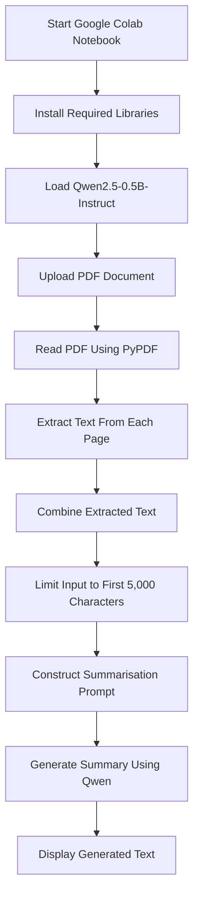

# AI-Powered PDF Summarizer

An automated, lightweight Python application designed for Google Colab that extracts text from uploaded PDF documents and generates concise, AI-powered summaries using the open-source **Qwen2.5-0.5B-Instruct** Large Language Model (LLM).

## 1. Project Overview

### Objective

Reading through lengthy documents, research papers and reports can be time-consuming. This project aims to simplify the process by automating PDF text extraction and summarisation using an open-source language model.

The application allows users to upload a PDF document, programmatically extract its text and generate an AI-powered summary without requiring paid API keys or external AI API subscriptions.

The project combines Python, Hugging Face Transformers and Qwen2.5-0.5B-Instruct to provide an accessible approach to automated document summarisation.

### Key Features

- Automated PDF uploading through Google Colab.
- Text extraction from individual PDF pages.
- AI-powered document summarisation.
- Open-source language model integration.
- No paid API keys or external AI API tokens required.
- Lightweight implementation using Python.

## 2. Technologies and Components

| Technology | Purpose |
|---|---|
| Python | Core programming language used to coordinate the application. |
| Hugging Face Transformers | Provides the pipeline used to load and run the language model. |
| Qwen2.5-0.5B-Instruct | Lightweight, instruction-tuned language model used for text generation and summarisation. |
| PyPDF | Extracts text from uploaded PDF documents. |
| PyTorch | Deep learning framework supporting model execution. |
| Google Colab Files API | Provides the interface for uploading local PDF documents into the Colab environment. |

## 3. System Architecture and Summarisation Workflow

The application follows a sequential processing pipeline, moving from document upload to text extraction and AI-generated summary output.

### Architecture Diagram



### How It Works

**Step 1: Environment Setup**

The required Python libraries are installed within the Google Colab environment using pip.

**Step 2: Model Initialisation**

Hugging Face Transformers loads the Qwen2.5-0.5B-Instruct model through its `pipeline()` function.

The model weights are downloaded from Hugging Face into the Colab runtime. No external API key or authentication token is required for this public model.

**Step 3: PDF Upload**

Google Colab's Files API provides an upload interface that allows users to select a PDF document from their local computer.

**Step 4: Text Extraction**

PyPDF opens the uploaded document and iterates through its pages.

The `extract_text()` method retrieves the available digital text from each page, which is then combined into a single string.

**Step 5: Input Truncation**

The extracted document text is restricted to the first 5,000 characters using Python string slicing.

This keeps the amount of text supplied to the model within the application's chosen input limit.

**Step 6: Prompt Construction**

The selected text is inserted into a structured prompt instructing the model to summarise the document and identify its important ideas and details.

**Step 7: AI Inference**

Qwen2.5-0.5B-Instruct processes the prompt and generates a response, with a maximum generation allowance of 300 new tokens.

**Step 8: Summary Output**

The generated text is displayed directly in the Google Colab notebook.

## 4. Installation and Execution Guide

The application is designed to run directly in Google Colab. A local Python installation is not required.

### Prerequisites

- A Google account.
- Internet connectivity.
- A web browser.
- A PDF document containing extractable digital text.

### Step 1: Open Google Colab

Navigate to:

https://colab.research.google.com/

Sign in with your Google account and select **New Notebook**.

### Step 2: Configure the Runtime

For improved performance, you can enable GPU acceleration.

1. Open the **Runtime** menu.
2. Select **Change runtime type**.
3. Under Hardware accelerator, select **T4 GPU**, if available.
4. Click **Save**.

GPU access depends on Google's availability and account limits. The original implementation does not explicitly configure GPU allocation, so performance will depend on the hardware available to the Transformers pipeline.

### Step 3: Install the Required Libraries

Create a code cell and paste the following installation commands:

```python
!pip install -q transformers torch pypdf accelerate
!pip install pypdf
```

Execute the cell and wait for the installation to finish.

### Step 4: Import Libraries and Load the Model

Create a new code cell and paste the following:

```python
import torch
from transformers import pipeline
from pypdf import PdfReader
from google.colab import files

print("Downloading and initializing Qwen2.5-0.5B-Instruct (No tokens required)...")

print("Downloading and initializing BART-Large-CNN...")
generator = pipeline(
    "text-generation",
    model="Qwen/Qwen2.5-0.5B-Instruct"
)

print("AI Model is fully loaded and ready to use!")
```

Execute the cell.

The model will be downloaded from Hugging Face and initialised in the Colab environment. The first download may take some time depending on your internet connection.

**Note:** The BART-Large-CNN message is retained from the original script. The actual model being loaded is Qwen2.5-0.5B-Instruct.

### Step 5: Upload and Extract the PDF

Create another code cell and paste:

```python
uploaded = files.upload()

filename = next(iter(uploaded))

print("You uploaded:",filename)

reader = PdfReader(filename)

texts= ""

print(f"The file {filename} contains {len(reader.pages)} page(s).")

for page in reader.pages:
  texts += page.extract_text() + "\n"
```

Execute the cell.

When the upload interface appears:

1. Click **Choose Files**.
2. Select the PDF document you want to summarise.
3. Wait for the upload to complete.
4. The notebook will identify the uploaded filename and number of pages before extracting the available text.

### Step 6: Generate the Summary

Create the final code cell and paste:

```python
short_text = texts[:5000]

prompt = f"""
Summarize the following text.
Include the important ideas and details.

TEXT:
{short_text}

SUMMARY:
"""

result = generator(prompt, max_new_tokens=300)

print(result[0]["generated_text"])
```

Execute the cell.

The extracted text is inserted into the prompt, passed to Qwen2.5-0.5B-Instruct and processed to generate the summary.

### Step 7: View the Output

Once inference is complete, the generated text will appear directly below the final code cell.

The application is now ready to use.

## 5. Important Limitation: 5,000-Character Input Ceiling

**The current implementation only processes the first 5,000 characters of extracted PDF text. It does not summarise the entire contents of longer documents.**

This limitation is imposed by the following line:

```python
short_text = texts[:5000]
```

Python string slicing selects characters from the beginning of the extracted text up to, but not including, character 5,000.

Consequently:

- Documents containing fewer than 5,000 extracted characters can be processed in full.
- Documents exceeding 5,000 characters are automatically truncated.
- Any content appearing after the first 5,000 characters is excluded.
- Important findings, conclusions and recommendations appearing later in a document may therefore be missed.

**Important distinction:** The 5,000-character restriction is an implementation choice in the current script, not the maximum context capacity of Qwen2.5-0.5B-Instruct.

### Proposed Improvement: Document Chunking

A future version could implement a chunking and MapReduce summarisation approach.

Rather than selecting only the first 5,000 characters, the application could:

1. Divide the extracted document text into smaller sections.
2. Generate an individual summary for each section.
3. Combine the individual summaries.
4. Pass the combined summaries through the model to produce a final document overview.

This would allow longer documents to be processed more comprehensively while managing the amount of text supplied to the model at each stage.

## 6. Limitations and Future Improvements

### 1. Long Document Processing

**Current limitation:** Only the first 5,000 characters of extracted text are summarised.

**Proposed improvement:** Implement document chunking and MapReduce summarisation to process longer documents.

### 2. Scanned PDF Documents

**Current limitation:** PyPDF extracts embedded digital text but cannot independently recognise text contained in scanned document images.

**Proposed improvement:** Integrate an Optical Character Recognition (OCR) engine, such as Tesseract OCR, to extract text from image-based PDF pages.

### 3. Model Capacity

**Current limitation:** The 0.5-billion-parameter model is lightweight and suitable for relatively simple summarisation tasks. However, its smaller size may affect its ability to capture complex arguments and subtle contextual relationships.

**Proposed improvement:** Experiment with larger Qwen model variants, such as Qwen2.5-3B-Instruct or Qwen2.5-7B-Instruct, when sufficient computational resources are available.

### 4. Summary Customisation

**Current limitation:** The current implementation uses a fixed prompt and a maximum generation allowance of 300 new tokens.

**Proposed improvement:** Introduce configurable summary lengths and output formats, such as bullet points, executive summaries and key findings.

## 7. Privacy and Data Handling

This project uses an open-source language model instead of relying on a separate paid AI summarisation API.

However, the application runs through **Google Colab, a cloud-based computing environment**. It should therefore not be described as completely private or as processing documents exclusively on the user's local computer.

When a PDF is uploaded:

- The document is transferred from the user's computer to the Google Colab runtime.
- PyPDF extracts its contents within that cloud environment.
- The extracted text is passed to the Qwen model running in the same runtime.
- The model generates the summary within the Colab environment.

The project does not require users to submit their document contents to a separate paid AI inference API. Nevertheless, the use of Google Colab involves cloud-based document processing.

Users should avoid uploading confidential, sensitive or personally identifiable documents unless they have reviewed the applicable data-handling policies and are comfortable with the associated risks.

Google Colab runtimes are temporary cloud environments subject to inactivity and maximum-lifetime restrictions. Users should disconnect and delete their runtime after completing their work, particularly when processing sensitive documents.

## 8. Project Summary

The AI-Powered PDF Summarizer demonstrates how Python, PDF-processing libraries and open-source language models can be combined to automate document summarisation.

By integrating PyPDF with Hugging Face Transformers and Qwen2.5-0.5B-Instruct, the project provides a lightweight approach to extracting information from PDF documents and generating AI-assisted summaries.

Although the current implementation has limitations involving document length, scanned PDFs and model capacity, it establishes a foundation for more advanced document-processing capabilities.

**Future development goal:** Expand the application to support comprehensive document summarisation, OCR integration and customisable summary generation.

## 9. References

- [Qwen2.5-0.5B-Instruct – Hugging Face](https://huggingface.co/Qwen/Qwen2.5-0.5B-Instruct)
- [Hugging Face Transformers Documentation](https://huggingface.co/docs/transformers/)
- [PyPDF Documentation](https://pypdf.readthedocs.io/)
- [Google Colab](https://colab.research.google.com/)
- [Google Colab FAQ](https://research.google.com/colaboratory/faq.html)
