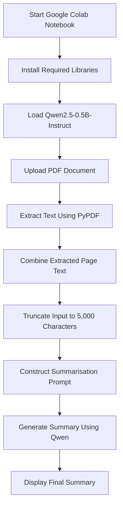

# AI-Powered PDF Summarizer

An automated, lightweight Python application built for Google Colab that extracts text from PDF documents and generates concise, AI-powered summaries using the open-source **Qwen2.5-0.5B-Instruct** language model.

## 1. Project Overview

### Objective

Reading lengthy documents, reports and research papers can be time-consuming. This project simplifies the process by automating PDF text extraction and summarisation using an open-source Large Language Model (LLM).

The application allows users to upload a PDF document, extract its text programmatically and generate a concise summary without requiring paid AI API subscriptions or external API keys.

The model runs within the Google Colab runtime rather than relying on a separate paid summarisation API.

### Key Features

- Automated PDF uploading and text extraction.
- AI-powered text summarisation.
- Lightweight, open-source language model.
- No paid API keys or external AI API subscriptions required.
- Google Colab compatibility.
- GPU acceleration when available.

## 2. Technologies and Components

| Technology | Purpose |
|---|---|
| Python | Core programming language used to coordinate the application. |
| Hugging Face Transformers | Loads and executes the language model. |
| Qwen2.5-0.5B-Instruct | Open-source, instruction-tuned language model used for summarisation. |
| PyPDF | Extracts text from individual PDF pages. |
| PyTorch | Provides the deep learning framework for model inference. |
| Accelerate | Supports automatic device mapping and hardware allocation. |
| Google Colab Files API | Provides the interface for uploading local PDF documents. |

## 3. System Architecture and Workflow

The application follows a straightforward processing pipeline.

### Architecture Diagram



### How It Works

**Step 1: Environment Setup**

The notebook installs the required Python libraries, including Transformers, PyPDF and Accelerate.

**Step 2: Model Initialisation**

Hugging Face Transformers downloads and loads the Qwen2.5-0.5B-Instruct model into the Colab runtime.

The application automatically selects an available hardware device using `device_map="auto"`.

**Step 3: PDF Upload**

Google Colab's Files API presents an upload interface, allowing the user to select a PDF document from their local computer.

**Step 4: Text Extraction**

PyPDF reads the uploaded document and extracts text from each page sequentially.

The extracted text is combined into a single string for further processing.

**Step 5: Input Truncation**

The combined text is restricted to the first 5,000 characters using Python string slicing.

This is an intentional limitation of the current implementation and is explained in Section 5.

**Step 6: Prompt Construction**

The extracted text is inserted into a structured instruction prompt asking the language model to identify the important ideas and produce a concise summary.

**Step 7: AI Inference**

Qwen2.5-0.5B-Instruct processes the prompt and generates a summary of up to 300 new tokens.

**Step 8: Summary Output**

The generated summary is displayed directly in the Google Colab notebook.

## 4. Installation and Execution Guide

The project is designed to run directly in Google Colab without requiring a local Python installation.

### Prerequisites

- A Google account.
- Internet connectivity for downloading the required libraries and model.
- A web browser.
- A PDF document containing extractable text.

### Step 1: Open Google Colab

Navigate to:

https://colab.research.google.com/

Sign in with your Google account and select **New Notebook**.

### Step 2: Configure the Runtime

For improved performance, configure the notebook to use GPU acceleration.

1. Open the **Runtime** menu.
2. Select **Change runtime type**.
3. Under Hardware accelerator, select **T4 GPU**, if available.
4. Click **Save**.

GPU availability depends on Google's current resource allocation and account limits. The application can also run on a CPU, although inference may be slower.

### Step 3: Install the Required Libraries

Create a code cell and execute:

```python
!pip install -q transformers pypdf accelerate
```

PyTorch is generally already available in Google Colab. If it is missing from your runtime, install it separately using the appropriate PyTorch installation instructions.

### Step 4: Import Libraries and Initialise the Model

Create another code cell and execute:

```python
import torch
from transformers import pipeline
from pypdf import PdfReader
from google.colab import files

# Select an appropriate precision for the available hardware
dtype = torch.float16 if torch.cuda.is_available() else torch.float32

print("Loading Qwen2.5-0.5B-Instruct...")

generator = pipeline(
    "text-generation",
    model="Qwen/Qwen2.5-0.5B-Instruct",
    torch_dtype=dtype,
    device_map="auto"
)

print("Model successfully loaded!")
```

**Note:** The first execution downloads the model weights from Hugging Face. This requires an internet connection and may take some time depending on network speed.

### Step 5: Upload and Extract the PDF

Create another code cell:

```python
# Upload a PDF document
uploaded = files.upload()

filename = next(iter(uploaded))

print(f"\nUploaded file: {filename}")

# Read the PDF
reader = PdfReader(filename)

print(f"Number of pages: {len(reader.pages)}")

# Extract text from all pages
texts = ""

for page in reader.pages:
    text_content = page.extract_text()

    if text_content:
        texts += text_content + "\n"

print(f"Extracted characters: {len(texts)}")

if not texts.strip():
    raise ValueError(
        "No extractable text found. "
        "The PDF may contain scanned images."
    )
```

### Step 6: Generate the Summary

Create the final code cell:

```python
# Limit the input to 5,000 characters
short_text = texts[:5000]

if len(texts) > 5000:
    print(
        "Warning: Document exceeds 5,000 characters. "
        "Only the first 5,000 characters will be summarised."
    )

# Construct the summarisation prompt
messages = [
    {
        "role": "system",
        "content": (
            "You are a helpful document summarisation assistant. "
            "Produce concise, accurate summaries that preserve "
            "the important ideas and details."
        )
    },
    {
        "role": "user",
        "content": (
            "Summarise the following document. "
            "Identify its main arguments, important findings "
            "and relevant details.\n\n"
            f"DOCUMENT:\n{short_text}"
        )
    }
]

prompt = generator.tokenizer.apply_chat_template(
    messages,
    tokenize=False,
    add_generation_prompt=True
)

print("\nGenerating summary...")

result = generator(
    prompt,
    max_new_tokens=300,
    do_sample=False,
    return_full_text=False
)

summary = result[0]["generated_text"]

print("\n========== DOCUMENT SUMMARY ==========\n")
print(summary)
print("\n======================================")
```

### Step 7: Run the Application

Execute the notebook cells sequentially, from top to bottom.

When the upload interface appears:

1. Click **Choose Files**.
2. Select a PDF document from your computer.
3. Wait for the PDF extraction process.
4. Allow the model to generate the summary.
5. Read the resulting summary displayed in the notebook.

The application is now ready to use.

## 5. Important Limitation: 5,000-Character Input Ceiling

**The current implementation does not summarise the entire contents of every uploaded PDF.**

The following line imposes a strict input restriction:

```python
short_text = texts[:5000]
```

Python string slicing selects only the first 5,000 characters of the extracted document.

Consequently:

- Short documents containing fewer than 5,000 extracted characters can be processed in full.
- Longer documents are truncated after the first 5,000 characters.
- Content appearing later in the document is excluded from the summarisation process.
- Important conclusions, findings or recommendations appearing towards the end of a lengthy document may therefore be missed.

It is important to distinguish between the model's context window and the application's current input restriction. Qwen2.5-0.5B-Instruct supports a substantially larger context than the 5,000-character limit imposed by this particular script.

The 5,000-character restriction is an implementation choice, not the model's maximum context capacity.

### Proposed Improvement: Document Chunking and MapReduce Summarisation

A future version could implement a chunking mechanism.

Instead of truncating the extracted text, the application would divide the document into smaller sections, summarise each section independently and combine the individual summaries into a final document overview.

This would allow the application to process substantially longer documents while managing the amount of text supplied to the model at each stage.

## 6. Limitations and Future Improvements

### 1. Long Document Processing

**Current limitation:** Only the first 5,000 characters are summarised.

**Proposed improvement:** Implement text chunking and MapReduce summarisation to process longer documents in manageable sections.

### 2. Scanned PDF Documents

**Current limitation:** PyPDF extracts embedded digital text but does not independently recognise text contained in scanned document images.

**Proposed improvement:** Integrate an Optical Character Recognition (OCR) solution to extract text from scanned pages.

### 3. Model Capacity and Summary Quality

**Current limitation:** The 0.5-billion-parameter model is lightweight and suitable for relatively simple summarisation tasks. However, its smaller size may affect its ability to interpret complex arguments and preserve subtle contextual relationships.

**Proposed improvement:** Experiment with larger Qwen model variants where sufficient computational resources are available.

### 4. Summary Customisation

**Current limitation:** The application generates a general-purpose summary with a fixed output limit of 300 new tokens.

**Proposed improvement:** Allow users to customise summary length, format and focus, such as executive summaries, key findings or bullet-point summaries.

## 7. Privacy and Data Handling

This application uses an open-source language model rather than sending document contents to a separate paid AI summarisation API.

However, **the application runs in Google Colab, which is a cloud-based computing environment. It should therefore not be described as entirely private or as processing documents exclusively on the user's local computer.**

When a PDF is uploaded, it is transferred to the Google Colab runtime, where its contents are extracted and processed. The model is also downloaded from Hugging Face into that environment.

Google explains that Colab executes code in a virtual machine associated with the user's account. These virtual machines are subject to idle deletion and maximum runtime limits.

Users should therefore:

- Avoid uploading confidential, sensitive or personally identifiable documents.
- Review Google's applicable privacy and data-handling policies before uploading documents.
- Avoid sharing notebooks containing sensitive outputs.
- Disconnect and delete the runtime when finished, particularly when working with documents that should not remain in the runtime environment.

The project reduces reliance on external AI inference APIs, but this does not eliminate cloud-based data processing.

## 8. Project Summary

The AI-Powered PDF Summarizer demonstrates how Python, open-source language models and document-processing libraries can be combined to automate a common information-management task.

By integrating PyPDF with Hugging Face Transformers and Qwen2.5-0.5B-Instruct, the application provides a lightweight, accessible approach to AI-assisted document summarisation.

The current implementation establishes the foundation for more advanced capabilities, including long-document processing, OCR integration and customisable summaries.

**Future development goal:** Evolve the prototype into a more comprehensive PDF summarisation tool capable of processing entire documents while maintaining efficient resource utilisation.

## References

- [Qwen2.5-0.5B-Instruct – Hugging Face](https://huggingface.co/Qwen/Qwen2.5-0.5B-Instruct)
- [Hugging Face Transformers Documentation](https://huggingface.co/docs/transformers/)
- [PyPDF Documentation](https://pypdf.readthedocs.io/)
- [Google Colab FAQ](https://research.google.com/colaboratory/faq.html)
- [Google Colab](https://colab.research.google.com/)
